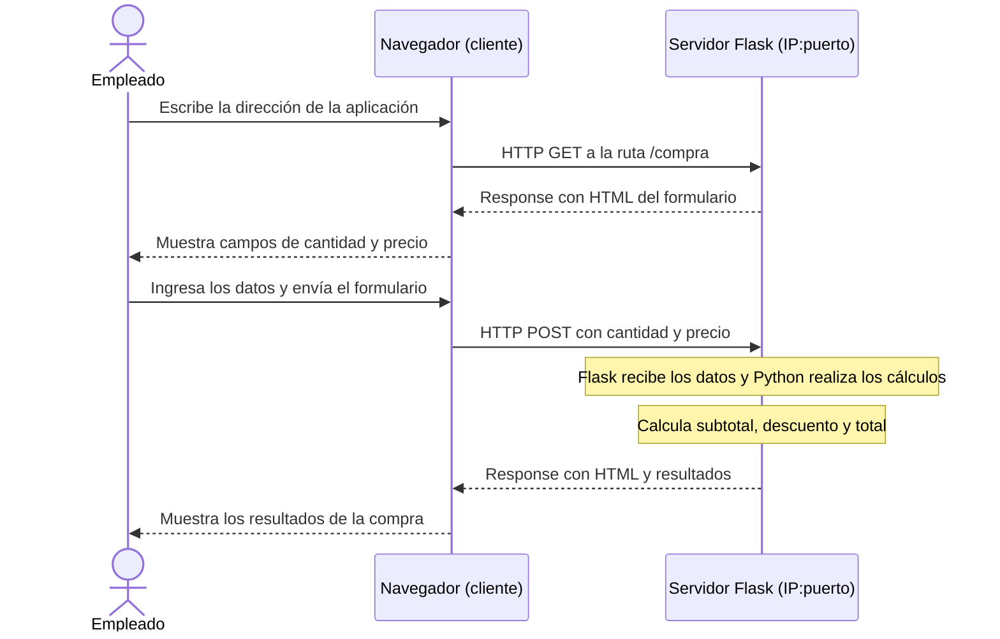

# Recorrido de la aplicación de compra

Cuando el empleado escribe la dirección de nuestra aplicación en el navegador, este funciona como el **cliente**, ya que es el encargado de comunicarse con el equipo donde está funcionando nuestro proyecto. La dirección que escribimos permite localizar el servidor mediante una **dirección IP** y un **puerto**, que indican a dónde debe conectarse el navegador.

Al ingresar por primera vez, el navegador envía una petición llamada **request** mediante el protocolo **HTTP**, utilizando el método **GET** para solicitar la página de compra. Esta petición llega a nuestro servidor, donde se encuentra la aplicación desarrollada con **Python y Flask**.

Flask recibe la petición y revisa qué **ruta** corresponde a la dirección solicitada. En este caso, ejecuta la ruta de compra y muestra el formulario donde el empleado puede ingresar la cantidad de artículos y su precio unitario.

Para mostrar esta página, Flask utiliza un **template**, que es una plantilla HTML donde se organiza el contenido que verá el usuario. El navegador recibe el código **HTML** y lo interpreta para mostrar el formulario. Esta parte es conocida como **frontend**, porque es con la que interactúa directamente el empleado. Por otro lado, los estilos **CSS** y **Bootstrap** permiten darle una mejor presentación a la página, organizando los campos, botones y demás elementos.

Una vez que el empleado ingresa la cantidad y el precio, presiona el botón para calcular la compra. En ese momento, el navegador envía otra petición HTTP, pero ahora utiliza el método **POST**, ya que necesita mandar los datos capturados al servidor.

Cuando Flask recibe esta petición, ejecuta nuevamente la ruta de compra, que ahora procesa los datos enviados por el formulario. Esta parte corresponde al **backend**, porque es donde se realizan las operaciones internas de la aplicación.

Mediante **Python**, recuperamos los valores de cantidad y precio, los convertimos a números y multiplicamos ambos para obtener el subtotal. Después, el programa revisa si el subtotal supera los $1,000. Si es así, aplica un descuento del 10 %; de lo contrario, mantiene el subtotal sin descuento. Finalmente, obtiene el total de la compra.

Después de realizar las operaciones, Flask envía los resultados al template de compra mediante `render_template()`. De esta manera, la página puede mostrar nuevamente los datos ingresados por el empleado, el subtotal, el descuento aplicado y el total a pagar.

Por último, el navegador recibe la respuesta del servidor y muestra los resultados en pantalla. Así, el empleado puede visualizar el cálculo directamente en nuestra aplicación, sin necesidad de revisar la consola de Python.

## Diagrama de comunicación

En conclusión, el funcionamiento de nuestra aplicación consiste en una comunicación entre el **cliente y el servidor**. Primero, el navegador solicita el formulario mediante GET; después, envía los datos mediante POST para que Flask y Python realicen los cálculos en el backend. Finalmente, el servidor devuelve una respuesta con los resultados en HTML, que se muestran al empleado en el navegador.

# Evidencias e interpretación de resultados
## Portal de Servicios

El presente documento contiene las evidencias de funcionamiento de las calculadoras desarrolladas en el proyecto Portal de Servicios, así como una breve interpretación de los resultados obtenidos.

## 1. Calculadora de Compra

**Datos de entrada:**
- Cantidad de artículos: 5
- Precio unitario: $250.00

**Resultados obtenidos:**
- Subtotal: $1,250.00
- Descuento del 10%: $125.00
- Total: $1,125.00

**Evidencia:**

[Ver evidencia de compra con descuento](evidencias/compra.png)

**Interpretación:**

El sistema multiplica la cantidad de artículos por el precio unitario para obtener un subtotal de $1,250.00. Debido a que el subtotal supera los $1,000.00, se aplica un descuento del 10%, equivalente a $125.00. Finalmente, se obtiene un total de $1,125.00.

### Prueba sin descuento

**Datos de entrada:**
- Cantidad de artículos: 2
- Precio unitario: $200.00

**Resultados obtenidos:**
- Subtotal: $400.00
- Descuento: $0.00
- Total: $400.00

**Evidencia:**

[Ver evidencia de compra sin descuento](evidencias/compra_sin_descuento.png)

**Interpretación:**

Como el subtotal no supera los $1,000.00, el sistema no aplica ningún descuento y conserva el importe original de la compra.

## 2. Calculadora de Salario

**Datos de entrada:**
- Horas trabajadas: 45
- Pago por hora: $100.00

**Resultados obtenidos:**
- Horas normales: 40
- Horas extra: 5
- Pago normal: $4,000.00
- Pago de horas extra: $1,000.00
- Salario total: $5,000.00

**Evidencia:**

[Ver evidencia de salario con horas extra](evidencias/salario.png)

**Interpretación:**

El sistema identifica que se trabajaron 45 horas. Las primeras 40 se pagan a la tarifa normal de $100.00, mientras que las 5 horas adicionales se pagan al doble, es decir, a $200.00 cada una. El salario total obtenido es de $5,000.00.

### Prueba sin horas extra

**Datos de entrada:**
- Horas trabajadas: 35
- Pago por hora: $100.00

**Resultados obtenidos:**
- Horas normales: 35
- Horas extra: 0
- Salario total: $3,500.00

**Evidencia:**

[Ver evidencia de salario sin horas extra](evidencias/salario_sin_horas_extra.png)

**Interpretación:**

El sistema determina que las 35 horas trabajadas se encuentran dentro del límite de 40 horas normales. Por lo tanto, no se generan horas extra y el salario corresponde a $3,500.00.

## 3. Conversor de Temperatura

**Dato de entrada:**
- Temperatura: 25 °C

**Resultados obtenidos:**
- Fahrenheit: 77 °F
- Kelvin: 298.15 K

**Evidencia:**

[Ver evidencia de conversión de temperatura](evidencias/temperatura.png)

**Interpretación:**

El sistema recibe la temperatura en grados Celsius y realiza las conversiones correspondientes utilizando las fórmulas matemáticas de Fahrenheit y Kelvin. Para una temperatura de 25 °C, se obtiene un resultado de 77 °F y 298.15 K.

## 4. Conclusión

El proyecto Portal de Servicios cumple con la implementación de tres calculadoras mediante Flask, utilizando formularios HTML con el método POST para recibir los datos y procesarlos mediante Python.

Los resultados son enviados a las plantillas HTML utilizando Jinja2, permitiendo visualizar tanto los datos capturados como los resultados de cada operación.

Además, se implementó una navegación común mediante una plantilla base, así como componentes de Bootstrap para mejorar la presentación y organización de la aplicación.